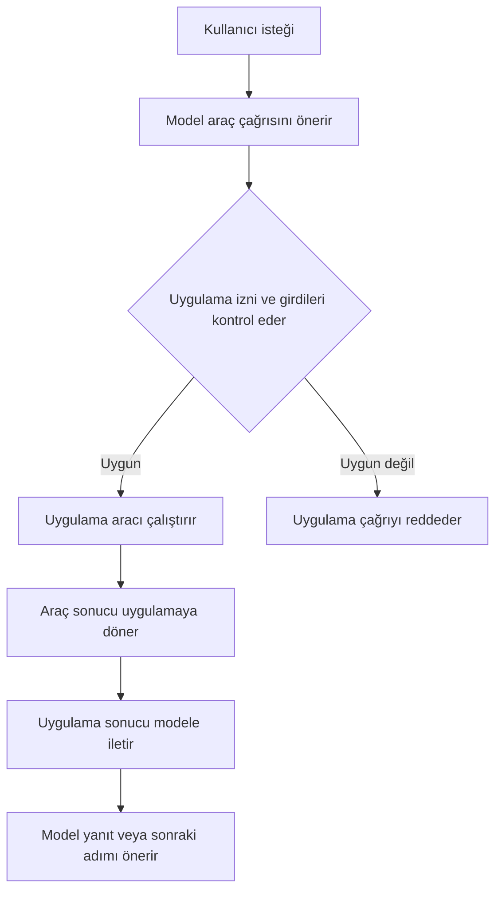

# Ders notları: LLM Temelleri

[Oturuma dön](README.md) | [English](lesson-notes.md) | [Sözlük](kavram-sozlugu.md)

Bu notlar birinci oturumun başvuru kaynağıdır. Öğrenme sırası LLM → Token → Vektör / Matris / Gömme → İşlev / API / Araç → Yapılandırılmış Çıktı / Şema şeklindedir; **bu sıralama her modelin birebir çalışma hattı değildir**. Deneyler için [Colab defterini veya yerel LLM deney alanını](demos/llm-playground/README.md) ve [çevrimdışı yapılandırılmış çıktı demosunu](demos/structured-output/README.md) kullanabilirsin.

## 1. LLM ve ajan ilişkisi

Büyük dil modeli (LLM), o ana kadar verilen bağlamı kullanarak bir sonraki token için olasılıklar hesaplar. Bir sonraki token seçildikten sonra süreç yeni bağlamla tekrarlanabilir; böylece bir yanıt oluşur. Modelin eğitimi çok daha geniş bir konudur, fakat burada üretimin temel mantığına odaklanıyoruz. Akıcı bir yanıt, bilginin doğruluğunu kanıtlamaz.

Bir **ajan sistemi**, modelin çevresine bağlam hazırlama, araç önerilerini değerlendirme, sonuçları işleme ve sonraki adımı belirleme gibi uygulama davranışları ekleyebilir. Her model çağrısı bir ajan değildir. Bir aracı modele tarif etmek, aracın çalıştırıldığı veya güvenilir bir sonuca ulaşıldığı anlamına da gelmez.

Örneğin “token nedir?” sorusunda model bir kavram arama aracı önerebilir. Uygulama bu öneriyi kontrol eder, uygun bulursa sözlük işlevini çalıştırır ve sonucu modele geri verir. Model aracı çağırmamayı da seçebilir.

## 2. Token, tokenization ve context window

**Tokenizer**, metni modelin kullandığı tokenlara ayırır. Bir token bir kelime, kelimenin parçası, boşluk, noktalama veya farklı bir parça olabilir. Token sayısı kelime veya karakter sayısına eşit olmak zorunda değildir; kullanılan tokenizer ve tam metin sonucu değiştirir. Bazı özel tokenlar konuşma sınırları gibi yapısal işaretler taşır.

**Token ID**, belirli tokenizer sözlüğündeki bir tokenın kimliğidir; tek başına vektör veya olasılık değildir. Unicode metin bazen birkaç tokenın baytlarıyla temsil edilir. Tek bir token ayrı çözümlendiğinde `�` gibi eksik bir karakter görülebilir; bu durum tek başına özgün metnin hatalı olduğu anlamına gelmez.

**Context window (bağlam penceresi)**, modelin bir seferde ele alabildiği token bütçesidir. Girdi ve konuşma geçmişi ile üretilecek tokenlar için ayrılan yer birlikte düşünülür. Modelin yapılandırılmış üst sınırı, kullanılan cihazın o uzunlukta çalışabileceğini garanti etmez; yerel demo sunucusunun ayarı ayrıca daha düşük olabilir.

### Deney A: İki dilde tokenlar

Colab'daki **3. bölümde (Tokenlara bak)** iki metni `Merhaba dünya!` ve `Hello world!` olarak dene; varsayılan örneklerin sonundaki el emojisini iki metinden de çıkar. Yerel arayüzde **Tokenlaştırma** moduna metinleri sırayla gir. Token sayısını, bir parçayı ve onun ID'sini kaydet. Tek bir örnekten dillerin tümü hakkında genelleme yapma.

### Deney B: Üretim ve örnekleme

Modelin **ham olasılık dağılımı**, belirli bağlamda aday sonraki tokenlara ilişkin tahminidir. Görülen ilk birkaç adayın olasılıkları %100'e toplanmak zorunda değildir; başka adaylar da vardır. Temperature, top-k ve top-p gibi **örnekleme** ayarları seçimi etkileyebilir. Düşük temperature daha olası seçenekleri öne çıkarabilir; yüksek değer dağılımı daha yaygın hâle getirebilir. Top-k aday sayısını, top-p ise olasılık eşiğine göre aday kümesini sınırlar.

Colab'da **4. bölüm (Gerçek sonraki token olasılıkları)**, yerelde **Üretim ve olasılıklar** bölümünü aç. İlk metin olarak `Bugün hava` kullan. Top-k ve top-p sabitken yalnız temperature'ı değiştir; Colab'daki ikinci çağrının `top_k` ve `top_p` değerlerini 20 ve 0.9 yap; sonra ilk ayarlara dönüp bağlamı `Kışın dağlarda bugün hava` yap. Aynı bağlamda ham dağılımı örnekleme sonrası dağılımla karıştırma. Yerel üretim sınırını 1 yapmak bir yeni token üretir; daha uzun üretim için sınır artırılabilir.

Colab tam model ağırlıklarını, yerel demo ise küçültülmüş GGUF sürümünü ve farklı bir çalıştırma yolunu kullanır. Sayılar ve örnekleme ayrıntıları birebir aynı olmak zorunda değildir; gözlemlenen değerleri karşılaştırırken bu farkı göz önünde tut.

## 3. Vektör / Matris / Gömme (Embedding)

Bir **vektör**, sayılardan oluşan sıralı bir liste gibi düşünülebilir; bir **matris** ise sayıların satır ve sütunlarla düzenlenmiş hâlidir. Aşağıdaki örnekte vektörün üç elemanı, matrisin iki satırı ve üç sütunu vardır:

$$
\mathbf{v} = \begin{bmatrix} 0.2 \\ -0.1 \\ 0.7 \end{bmatrix} \in \mathbb{R}^{3},
\qquad
\mathbf{M} = \begin{bmatrix} 0.2 & -0.1 & 0.7 \\ 0.4 & 0.5 & -0.2 \end{bmatrix} \in \mathbb{R}^{2 \times 3}
$$

Bu sayılar gerçek modelden alınmamış, gösterim amaçlı değerlerdir. Matrisin her satırı, üç sayıyla temsil edilen ayrı bir örnek vektör olarak okunabilir. **Embedding**, örneğin bir token veya metni sayısal vektörle temsil etme yöntemidir; boyut sayısı kullanılan modele bağlıdır. Bazı embedding uzaylarında vektör yakınlığı ilişkili içerikleri bulmaya yardımcı olur; bu yakınlık tek başına doğruluk garantisi değildir. Her koordinata tek başına bir kelime anlamı yüklemek gerekmez.

Bir token ID'si sözlükteki kimliği, embedding sayısal temsili, olasılık dağılımı ise aday devamlar üzerindeki model tahminini ifade eder. Bunlar farklı şeylerdir.

## 4. İşlev / API / Araç ve tool calling

Bir **function (işlev)**, çağrıldığında tanımlı bir iş yapan kod parçasıdır. **API**, bir yazılımın sunduğu işlev veya verilere erişim kurallarını tarif eden arayüzdür. Bir **tool (araç)**, uygulamanın modele belirli koşullarla kullanıma açtığı bir yetenektir.

Aşağıdaki diyagram bir **örnek akış** gösterir. Modelin önerisi kodu kendiliğinden çalıştırmaz; uygulama veya harness izinleri ve girdileri kontrol eder:



### Deney C: Bir sözlük aracını gözlemle

Colab'daki **6. bölüm (Araç çağrısı)** hücresini veya yerel **Araç çağrısı** modunu aç. `What is a token? Use lookup_term first.` sorusuyla dene. Model araç adını ve `term` argümanını önerirse, harness yalnız izin verilen tek çağrıyı ve argümanı doğrular; yerel sabit sözlükten gelen gerçek sonuç modele iletilir. Hangi adımın model, hangisinin uygulama tarafından yapıldığını ayrı ayrı kaydet. Model çağrı önermezse veya öneri geçerli değilse araç çalıştırılmaz.

## 5. Yapılandırılmış Çıktı / Şema ve JSON

**JSON**, nesne, metin, sayı, boolean ve liste gibi değerleri metin olarak gösteren bir veri biçimidir. **JSON Schema**, beklenen alanları, veri türlerini ve başka kuralları tanımlayabilir. Geçerli JSON olmak, belirli bir şemaya uymak ve içeriğin doğru olması üç ayrı kontroldür.

Aşağıdaki örnek demo şemasına uyar ama açıklaması yanlıştır:

```json
{"term": "token", "found": true, "explanation": "Token her zaman bir kelimedir."}
```

`found` alanını `"true"` yaparsan sonuç hâlâ geçerli JSON'dur; ancak değer boolean yerine metin olduğundan demo şemasına uymaz. Şema, türleri doğru bir açıklamanın anlamsal olarak doğru olduğunu tek başına kanıtlamaz.

### Deney D: Çevrimdışı şema kontrolü

[Mini demoyu](demos/structured-output/README.md) `token` ve bilinmeyen bir kavramla çalıştır; `term`, `found` ve `explanation` alanlarını incele. Aynı demodaki `schema_lab.py`, kasten yanlış açıklama örneğinin şemayı geçtiğini ve `found` alanının metin yapılmasıyla şemanın reddedildiğini gösterir. Demo **LLM veya harici API çağırmaz**. Yerel doğrulayıcı yalnız demo şemasında kullanılan küçük özellik kümesini kontrol eder, genel amaçlı JSON Schema doğrulayıcısı değildir. Pratik sorular [alıştırmalar](exercises/README.md) bölümündedir.
