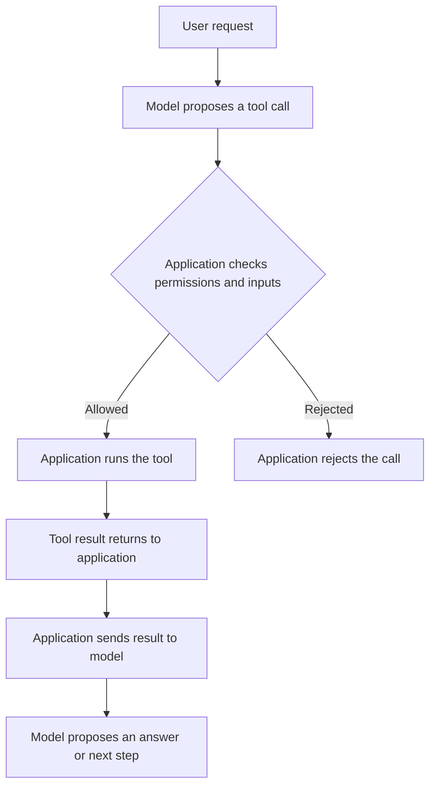

# Lesson notes: LLM Fundamentals

[Back to session](README.en.md) | [Türkçe](ders-notlari.md) | [Glossary](glossary.md)

These notes are a reference for session one. The teaching order is LLM → Token → Vector / Matrix / Embedding → Function / API / Tool → Structured Output / Schema; **this is not the literal execution pipeline of every model**. For the activities use the [Colab notebook or local LLM playground](demos/llm-playground/README.en.md) and the [offline structured-output demo](demos/structured-output/README.en.md).

## 1. LLMs and their relationship to agents

A large language model (LLM) uses the supplied context to calculate probabilities for the next token. Once a token is selected, the process can repeat with the updated context, forming a response. Model training is a much larger topic; here we focus on the basic generation process. A fluent answer does not prove the information is correct.

An **agent system** can surround the model with application behavior such as preparing context, checking tool proposals, handling results, and deciding what to do next. Not every model call is an agent. Describing a tool to a model does not mean the tool was executed or that the result is reliable.

For example, when asked “What is a token?”, a model might propose a concept lookup. The application checks the proposal, executes the lookup if allowed, and passes the result back to the model. The model may also choose not to call a tool.

## 2. Tokens, tokenization, and context windows

A **tokenizer** divides text into the tokens used by the model. A token may be a word, part of a word, a space, punctuation, or another piece. Token count need not equal word or character count; the tokenizer and exact text affect the result. Some special tokens mark structure such as conversation boundaries.

A **token ID** identifies a token in a particular tokenizer's vocabulary; it is neither a vector nor a probability. Unicode text may span byte fragments across several tokens. Decoding a token on its own can show a replacement character such as `�`; that alone does not mean the original text was broken.

The **context window** is the token budget a model can process at one time. Input and conversation history, together with space reserved for generation, use that budget. A model's configured maximum does not guarantee that a given device can handle that length; the local demo server can be configured with a smaller limit.

### Experiment A: Tokens in two languages

In Colab, use section **3 (Inspect tokens)** with `Merhaba dünya!` and `Hello world!`; remove the waving-hand emoji from both default examples. In the local interface, enter each text under **Tokenization**. Record the token count and one piece with its ID. Do not generalize about entire languages from one example.

### Experiment B: Generation and sampling

The model's **raw probability distribution** is its prediction over candidate next tokens for a particular context. The top few displayed probabilities need not sum to 100% because other candidates exist. **Sampling** settings such as temperature, top-k, and top-p can affect selection. A lower temperature can favor the most likely choices; a higher value can flatten the distribution. Top-k limits the number of candidates; top-p limits the set using a probability threshold.

Open Colab section **4 (Real next-token probabilities)** or **Generation and probabilities** locally. Start with `Bugün hava`. Keep top-k and top-p fixed while changing only temperature; in the second Colab call set `top_k` to 20 and `top_p` to 0.9; then restore the starting settings and change the context to `Kışın dağlarda bugün hava`. Distinguish the raw distribution from the post-sampling distribution. A local generation limit of 1 produces one new token; increase it for a longer continuation.

Colab uses full model weights, while the local demo uses a smaller GGUF version and a different runtime. Numbers and sampling details need not match exactly; account for that difference when comparing observations.

## 3. Vector / Matrix / Embedding

Think of a **vector** as an ordered list of numbers and a **matrix** as numbers arranged in rows and columns. Here, the vector has three entries, and the matrix has two rows and three columns:

$$
\mathbf{v} = \begin{bmatrix} 0.2 \\ -0.1 \\ 0.7 \end{bmatrix} \in \mathbb{R}^{3},
\qquad
\mathbf{M} = \begin{bmatrix} 0.2 & -0.1 & 0.7 \\ 0.4 & 0.5 & -0.2 \end{bmatrix} \in \mathbb{R}^{2 \times 3}
$$

The numbers are illustrative, not model outputs. Each matrix row can be read as a separate example vector with three numbers. An **embedding** represents an item such as a token or text as a numerical vector; its dimension depends on the model. In some embedding spaces, nearby vectors help retrieve related content, but proximity alone does not prove truth. An individual coordinate need not correspond to a standalone word meaning.

A token ID is a vocabulary identifier, an embedding is a numerical representation, and a probability distribution is the model's prediction over possible continuations. These are different things.

## 4. Function / API / Tool and tool calling

A **function** is code that performs a defined task when called. An **API** is an interface describing how to access software capabilities or data. A **tool** is a capability an application makes available to a model under specified conditions.

This is one **example flow**. A model proposal does not execute code by itself; the application or harness checks permissions and inputs:



### Experiment C: Observe a glossary tool

Run Colab section **6 (Tool calling)** or choose **Tool calling** locally. Try `What is a token? Use lookup_term first.` If the model proposes the tool and `term` argument, the harness checks that there is one allowed call with an allowed argument; the actual result from a fixed local glossary is sent back to the model. Record which stage belongs to the model and which to the application. If there is no valid proposal, no tool is run.

## 5. Structured Output / Schema and JSON

**JSON** represents structured values such as objects, strings, numbers, booleans, and lists as text. **JSON Schema** can describe expected fields, types, and other constraints. Being valid JSON, conforming to a particular schema, and containing correct information are three separate checks.

The object below conforms to the demo schema, but the explanation is false:

```json
{"term": "token", "found": true, "explanation": "A token is always a word."}
```

Changing `found` to `"true"` still gives valid JSON, but it no longer conforms to the demo schema: the value is a string rather than a boolean. A schema alone does not establish the factual correctness of an otherwise well-typed explanation.

### Experiment D: Offline schema checking

Run the [mini demo](demos/structured-output/README.en.md) with a known and an unknown term; inspect `term`, `found`, and `explanation`. Its `schema_lab.py` also shows that the intentionally false example explanation passes the schema, while changing `found` to a string fails it. It **does not call an LLM or external API**. Its local validator checks only the small subset used in its demo schema; it is not a general-purpose JSON Schema validator. Practice questions are in the [exercises](exercises/README.en.md).
