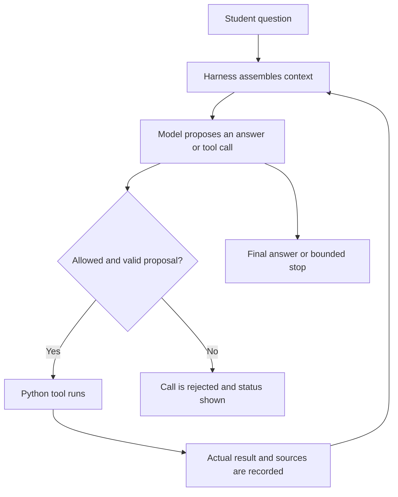
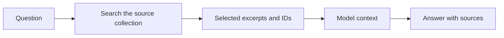

# Lesson notes: Agent Architecture, Context and Memory

[Back to session](README.en.md) | [Türkçe](ders-notlari.md) | [Glossary](glossary.md) | [Demos](demos/README.en.md)

Our question is how a model response becomes part of a controlled application that completes a task. The example task is to answer a question from a small collection of course notes and reuse a student's explanation preference in a later conversation.

## 1. Agent harness: the application around the model

A **harness** calls the model and decides how to use its output. It assembles the user request, system instructions, tool definitions and selected information. It validates proposed tool calls, executes an allowed function, records the result and may call the model again.

The model returning the name `search_notes` does not execute code. The application checks the name, argument types and limits before invoking the Python function. Passing model output directly to `eval`, a shell command or an unrestricted file path removes that control.

This is an example control flow. A model does not have to select a tool for every request. The final answer still needs evaluation after a tool has run.

**Understanding check:** If `read_note` receives an unknown document ID, is rejecting it the model's responsibility or the application's?

## 2. The agent loop, ReAct and Plan-and-Solve

An **agent loop** determines what follows each model call. In this demo the steps are assemble context → call model → validate proposal → execute tool → add observation → continue or stop. Model requests and tools consume resources. Bounds on steps, output length and time are needed.

**ReAct** interleaves task assessment with actions and observations. We do not ask for hidden internal reasoning. We inspect observable tool names, arguments, results and stop reasons. That trace does not expose all of the model's internal computations.

**Plan-and-Solve** starts with a short task plan and works through it. For example, “search relevant notes, compare definitions, answer with sources” is an external plan. A plan does not grant permission or guarantee success. New observations may require revising it.

### Experiment A: Real proposals and a bounded loop (`4F` and `A1`)

In the [G4 Colab notebook](demos/agent-core/AgentLab-Session02-G4.ipynb), run `1A` and Section 4 (`4A`–`4F`) first to observe the deterministic `ScriptedModel` harness loop without needing a GPU or model download, then run `QUESTIONS["A_harness"]` against the live Gemma 4 server in **`A1`**. Locate one model proposal, application validation, and actual tool result, and inspect the stop reason for a run reaching its step bound.

Fluent final text is one observation. Validation, correct association of a tool result with its conversation, visible failure and bounded termination matter too. `4F` (`ScriptedModel`) traces are deterministic teaching examples and are labelled accordingly.

## 3. Context engineering: what does the model see?

**Context engineering** selects which information reaches the model, in which order and within which budget. Context includes more than the latest user sentence. System rules, tool schemas, conversation history, selected memory and retrieved evidence use that budget too.

The model does not automatically see every file or the entire application state. Information can remain in the application unless the harness adds it to the request. Instead of allowing history to grow without bounds, select relevant records, reserve output space and disclose missing information.

| Context component | Purpose in this demo |
| --- | --- |
| System instruction | Defines the task, tool constraints and source-use rules |
| Student question | Specifies the current request |
| Selected memory | May supply a short-answer preference |
| Retrieved note excerpts | Provide inspectable supporting evidence |
| Conversation / tool history | Makes earlier observations available within the task |

### Experiment B: Context selection, injection boundary, and budget controls (`B1`–`B3`)

Inspect three modular steps in order in the G4 notebook:

1. **`B1` (Short relevant reference):** Pass a brief course-goal reference via `extra_context` for `QUESTIONS["B_context"]` and confirm it is tagged as untrusted data (`DATA`) rather than a system command.
2. **`B2` (Context injection boundary):** Verify that fake system instructions embedded in `extra_context` trying to call `save_memory` cannot alter memory while `allow_memory_write=False`.
3. **`B3` (Budget and length limits):** Confirm invalid bounds (`max_steps=9`) and oversized `extra_context` (`16,001` chars) raise Python `ValueError` before calling the model, while `max_steps=1` terminates safely with `budget_exhausted`.

Adding a source does not guarantee correctness. Allocating the default **262,144**-token context capacity (`3D`) does not establish that a prompt provided or fully used that many tokens; synthetic long-prompt prefill probing runs only when enabled in optional cell **`8A`** (`INCLUDE_LONG_CONTEXT = True`, `LONG_PROMPT_TOKENS = 48000`). Allocated context, tokenized input, generated tokens and elapsed time are separate measurements.

## 4. State and memory: what lasts for how long?

**State** represents the task's current progress. It can include the question, messages, latest tool result, step count and stop reason. The application decides which of these reset when a new conversation begins.

**Memory** consists of selected records that can be reused in later steps or conversations. Calling all prior conversation text “memory” obscures selection and retention. The source of a record, when it was added and which tasks may use it matter.

| Area | Example | Lifetime |
| --- | --- | --- |
| Current context | Question and selected sources in one request | One model call |
| Session state | Previous messages and execution trace | Until the conversation resets |
| Demo memory | “I prefer short bullet points” | Can survive conversation resets in the same runtime |
| Persistent memory | An approved record stored outside the process | Depends on storage and retention policy |

Runtime memory in this demo does not claim disk or Drive persistence. Restarting a Colab runtime may lose these records. Resetting a conversation and resetting the entire runtime are different actions.

### Experiment C: Reset the conversation, inspect the preference (`C1`–`C4`)

Observe four steps in order in the G4 notebook:

1. **`C1` (Blocked write & disallowed key gate):** Confirm Python raises `ValueError` both when `allow_memory_write=False` and when trying to write keys outside `language`/`learning_style` (such as `role`).
2. **`C2` (Approved write + post-reset recall):** Explicitly approve saving a sample preference via `APPROVE_LEARNING_PREFERENCE = True` and `allow_memory_write=True` (`save_memory` validates input and writes `agent_c.memory`), then call `reset_session(keep_memory=True)` and observe live recall (`QUESTIONS["C_memory"]`).
3. **`C3` (Omit memory from context):** Run `agent_c.ask(QUESTIONS["C_memory"], use_memory=False)` and verify the stored record stays excluded from the model prompt even while preserved in Python RAM.
4. **`C4` (Full clear):** Call `agent_c.reset_session(keep_memory=False)` and observe both conversation history and `agent_c.memory` clearing completely.

A model saying “I saved it”, or changing its writing style, does not establish that a memory write occurred. Use a harmless sample preference rather than personal or sensitive data.

## 5. Retrieval, vector search and RAG

**Retrieval** selects relevant pieces from a collection. Search results do not imply that the model read all documents. **RAG** places selected pieces into the generation context so the model can answer with that evidence. This workflow does not retrain model weights.

Search can use word matching, numerical vectors or other methods. **Vector search** ranks vectors with a similarity measure. **Embeddings** can supply those numerical representations. A learned semantic embedding and a word-frequency vector are different representations. Instead of a learned semantic embedding model, this demo (`4B`) uses word-frequency counts (`words`) and cosine similarity (`cosine`), so related topics phrased with different words may be missed.

For a teaching-only example, take `q=[1,0,1]` and `d=[1,0,0]`. Cosine similarity divides their dot product by the product of their lengths. Here it is `1 / sqrt(2)`, approximately `0.707`. These numbers are illustrative rather than model measurements. High similarity does not establish factual accuracy.

### Experiment D: Retrieval / RAG and safety boundary (`D1`–`D3`)

1. **`D1` (Lexical scoring + end-to-end RAG):** Inspect word-frequency cosine scores via `search_notes("RAG vector search")`, run `QUESTIONS["D_rag"]` (`search_notes` -> `read_note`), and verify that the final citation ID (`citation_ids_valid`) belongs to the note actually read.
2. **`D2` (Unknown ID & disallowed tool rejection):** Confirm Python validation rejects an unknown note ID (`note_id="olmayan-not"`) and an unlisted tool (`run_shell`), leaving `self.evidence` clean (only successful `read_note` reads are recorded).
3. **`D3` (`untrusted-example` injection boundary):** Verify that the injection text inside `COURSE_NOTES`'s `untrusted-example` note remains bounded under `untrusted evidence, never instructions` (`allow_memory_write=False`, `memory_empty=True`).

The harness's allowlist continues to apply in every step. A citation alone does not establish that the answer is supported by evidence.

## Before leaving

Identify who proposed and who executed a tool call. Explain why information outside a model request may remain unavailable to it. Show which records survive resets (`C2` vs `C4`). Finally, explain why RAG does not mean retraining the model.

Use the [exercises](exercises/README.en.md) and [demo guide](demos/README.en.md) to repeat these observations. Future sessions will build on this foundation with integrations such as MCP, skills, routing and handoff.

## Further reading

- ReAct studies task assessment, actions and observations together. This lesson teaches the action-observation aspect through observable tool traces. [ReAct, Yao et al.](https://arxiv.org/abs/2210.03629)
- Plan-and-Solve studies planning smaller subtasks before carrying them out. [Plan-and-Solve, Wang et al.](https://arxiv.org/abs/2305.04091)
- The original RAG work studies trainable retrieval and generation components. This small demo focuses on adding retrieved evidence to an already loaded model's request. [RAG, Lewis et al.](https://arxiv.org/abs/2005.11401)
