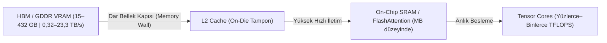
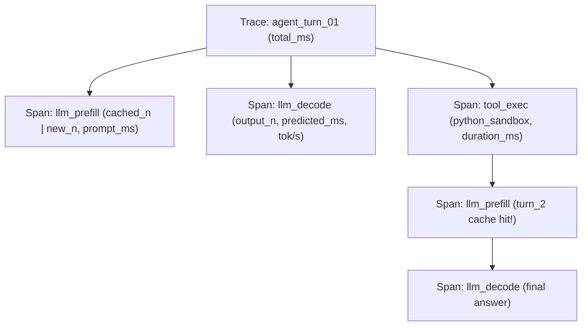
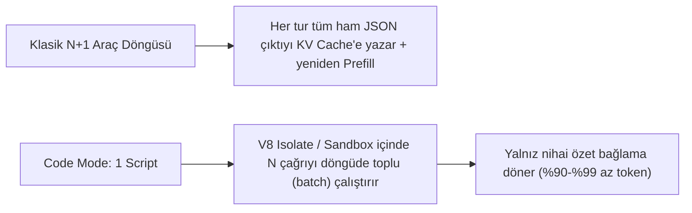

# Ders notları: Altyapı, Performans, Maliyet ve Değerlendirme

[Oturuma dön](README.md) | [English](lesson-notes.md) | [2026 Donanım Referansı](donanim-referansi-2026.md) | [Sözlük](kavram-sozlugu.md) | [Demolar](demos/README.md) | [Etkileşimli Simülatör](demos/inference-visualizer/prefill-decode-kv-sim.html)

İlk dört günde bir modelin token/JSON üretmesini, **harness** döngüsünü, `MCP` araç keşfini, çoklu ajan devrini ve `Sandbox`/`HITL` güvenliğini kurduk. Bugünkü soru şudur: **Güvenli çalışan bir ajanı gerçek kullanıcı trafiğine açtığımızda onu nasıl hızlandırır, bellek ve enerji bütçesini nasıl düşürür, her adımını nasıl izler ve kalitesini sistematik olarak nasıl doğrularız?** Bu notlar, üç donanım katmanında (`G4/H100`, `L4`, `T4`) aynı **`Gemma 4 12B QAT + MTP`** modelini elma-elma koşturan **7 hücreli `#@title` Colab defterleri** ([demolar](demos/README.md)) ve çevrimdışı [etkileşimli simülatör](demos/inference-visualizer/prefill-decode-kv-sim.html) ile birebir eşleşir.

## 5 Dakikalık Gün 1–4 Köprü Özeti

> **Ders zamanı kuralı:** Geçmiş günlerin uzun tekrarıyla zaman kaybetmiyoruz; ayrıntılar için [Gün 1](../01-llm-fundamentals/ders-notlari.md), [Gün 2](../02-agent-core-and-state/ders-notlari.md), [Gün 3](../03-modern-agent-stack/ders-notlari.md) ve [Gün 4](../04-security-and-execution/ders-notlari.md) ders notları ödevdir. Bugün için yalnız şu **4 önkoşulu** bilmek yeterlidir:

| Gün | Anahtar Kavram | Gün 5 İçin Bilmen Gereken Tek Cümle |
| --- | --- | --- |
| **Gün 1** | **Token, Matris & Structured Output** | Her istek token ID'lerinden matris/vektör çarpımlarına dönüşür; şemaya uyan çıktı hâlâ pahalı, yavaş veya yanlış olabilir. |
| **Gün 2** | **Agent Harness & KV/State Belleği** | Ajan döngüsü (`Plan → Eylem → Gözlem`) dış harness'ta koşar; her ek tur bağlamı büyüterek KV belleği ve prefill yükünü artırır. |
| **Gün 3** | **MCP, Handoff & Hibrit Yönlendirme** | Çoklu ajan ve araç çağrıları arka arkaya LLM turu açar; gereksiz çağrıları deterministik kapıda kesmek maliyeti doğrudan düşürür. |
| **Gün 4** | **Sandbox, HITL & Durable Execution** | Gerçek kod yürütme ve `checkpoint`/`resume` izleri üretime hazırdır; şimdi bu yürütmeyi hız, `KV`, `$/1M Token`, `Joule/Token`, `Tracing` ve `Evals` ile mühendislik altına alıyoruz. |

---

## 1. Inference Performansı, Bellek Hiyerarşisi ve Roofline Modeli (5.1)

Bir LLM'i çalıştırmak (*Inference*) iki çok farklı fiziksel rejime ayrılır: girdi istemini işleyen **Prefill** ve yanıtı token token üreten **Decode**. Bu ayrımı anlamadan doğru GPU veya doğru sunucu ayarı seçilemez. (Canlı animasyon için [etkileşimli simülatörün 1. ve 2. sekmelerini](demos/inference-visualizer/prefill-decode-kv-sim.html) ve tüm donanım değerleri için [2026 Donanım Referansını](donanim-referansi-2026.md) aç.)

### 1.1 GPU Bellek Hiyerarşisi (`HBM → L2 → SRAM → Tensor Cores`) ve Bellek Duvarı

Hesaplama birimleri (**Tensor Cores**) veriyi yalnızca çip üzerindeki çok küçük ama ultra hızlı **SRAM** (register / shared memory) katmanından besler. Ağırlıklar ise dışarıdaki büyük **HBM / GDDR** bellekte yaşar:



**Roofline Modeli** bize tek bir kritik sınır gösterir:
- **Compute-Bound (Hesaplama Sınırlı):** Bir ağırlığı bellekten bir kez okuyup çok sayıda token üzerinde aynı anda çarpabiliyorsak (ör. **Prefill** veya büyük **Batch**), Tensor Core'lar tam kapasite çalışır.
- **Memory-Bound / Memory Wall (Bellek Duvarı):** Tek kullanıcı (`batch=1`) otoregresif **Decode** sırasında her yeni token için modelin **tüm aktif ağırlıklarını** HBM/VRAM'den yeniden okumak zorundayız. Bu durumda Tensor Core'ların %95'i veri beklerken boş yatar ve tavan hızı yalnız bellek bant genişliği belirler:

$$\text{Max tok/s} \approx \frac{\text{Bellek Bant Genişliği (GB/s)}}{\text{Aktif Ağırlık Boyutu (GB)}}$$

Örneğin **`Gemma 4 12B Q4_0` (`~7,2 GB`)** için teorik decode tavanı `Tesla T4` (`320 GB/s`) üzerinde **`~44 tok/s`**, `RTX PRO 6000 Blackwell` (`1.792 GB/s`) üzerinde **`~249 tok/s`**, `NVIDIA H100 SXM` (`3,35 TB/s`) üzerinde **`~465 tok/s`**, `AMD MI455X` (`23,3 TB/s` HBM4) üzerinde **`~3.236 tok/s`** olur; pratikte çekirdek/KV/MTP ek yüküyle bunun **%60–80'i** gözlenir.

### 1.2 Cerebras Wafer-Scale (`WSE-3 / WSE-3T CS-4`) vs GPU Kümeleri

Geleneksel GPU'larda bellek duvarı HBM yongalarının çip dışında olmasından doğar. **Cerebras**, 300 mm silikon plakasını (`wafer`) kesmeden tek dev çip hâlinde bırakarak **`44 GB` On-Chip SRAM**'i doğrudan `900.000` SLAC çekirdeğinin içine dağıtır:
- **`WSE-3` (`CS-3`):** `21,0 PB/s` on-chip SRAM bant genişliği, `125 PFLOPS` (sparse).
- **`WSE-3 Turbo / WSE-3T` (`CS-4`):** **`43,2 PB/s`** on-chip SRAM bant genişliği, **`250 PFLOPS`** / wafer (`53,5 PB/s` wafer fabric; `3×` CS-4 rafında `750 PFLOPS`). *(Not: Kasım 2026 itibarıyla resmi `WSE-4` spesifikasyonu henüz çıkmadığından aktif amiral `CS-4` içindeki `WSE-3T` dir.)*
- **Canlı Sonuç ve Ödünleşim:** Ağırlıklar doğrudan SRAM içinde yaşadığından HBM duvarı ortadan kalkar (`GPT-5.6 Sol Ultrafast ~750 tok/s`, ~`14×` hızlanma — damıtma olmadan aynı ağırlıklar). Ancak aynı güç ve maliyet bütçesindeki GPU/TPU kümelerine göre yoğun matris hesaplama (*dense compute* / FLOPS/$) yoğunluğu daha düşük olduğundan, devasa **ön-eğitim** (*pre-training*) için GPU/TPU kümeleri, **ultra düşük gecikmeli decode ve ajan akışları** için wafer-scale öne çıkar.

### 1.3 Chunked Prefill (`--ubatch-size`), Saf Decode (`GEMV`) ve Continuous Batching

| Aşama / Strateji | Matematik İşlemi | Roofline Rejimi | Pratik Etki |
| --- | --- | --- | --- |
| **Chunked Prefill (`--ubatch-size`)** | `[B × d] × W` (**GEMM** — matris × matris) | **Compute-Bound** | Uzun istemleri `64..512` tokenlık parçalara bölerek KV raflarını doldurur; tek uzun istemin diğer kullanıcıları tıkamasını önler. |
| **Saf Decode (`batch=1`)** | `[1 × d] × W` (**GEMV** — matris × vektör) | **Memory-Bound** | Her adımda 1 token için tüm ağırlıklar okunur; Tensor Core'lar boş bekler, **TPOT** bant genişliğine kilitlenir. |
| **Continuous Batching (`N` kullanıcı)** | `[N × d] × W` (**GEMM**) | **Compute-Bound'a geçiş** | İterasyon düzeyinde `N` kullanıcının decode adımı birleştirilir; aynı ağırlık okumasıyla `N` token birden üretilir, toplam `tok/s` katlanır. |

### 1.4 Nicemleme (`FP16 / FP8 / NVFP4 / Q4_0`) ve Speculative Decoding (`MTP` & `DFLASH`)

- **Nicemleme (Quantization):** Ağırlık ve KV tensörlerini `FP16` (`2 bayt`) yerine **`FP8`** (`1 bayt`), **`NVFP4`** veya **`Q4_0`** (`~0,5 bayt`) biçiminde saklamak, okunan bayt miktarını yarıya veya dörtte bire indirerek hem VRAM kapasitesini açar hem decode tavanını doğrudan yükseltir.
- **MTP (Multi-Token Prediction):** Küçük bir taslak başlığı (ör. `gemma-4-12B-it-assistant`, `4` katman, `~253 MB`) ardışık olarak `k` aday token taslağı önerir; ana model bu adayları tek bir mini-GEMM geçişinde **kayıpsız** (*lossless*) doğrular. Önemli üretim gerçeği: **MTP hem tek kullanıcıda (`batch=1`) hem de çok kullanıcılı `Continuous Batching` altında çalışır** (ör. Oturum 02 G4 `vLLM` 8-oturum MTP5 testinde `619,2 tok/s`).
- **DFLASH (Block Diffusion Speculative Decoding):** Taslak tokenları sırayla (`t+1, t+2, ...`) üretmek yerine tek bir paralel blok difüzyon ileri geçişinde **`8–16` taslak tokenı aynı anda** önerir ve ana modelin tek mini-GEMM geçişiyle doğrular; kabul oranı (`α`) yüksek işlerde taslak aşamasının ardışık gecikmesini de kırar.

<details>
<summary>🔬 İsteğe Bağlı Derinlik: <code>Gemma 4 12B</code> (<code>config.json</code>) Gerçek Tensör Geometrisi ve Mini PyTorch İskeleti</summary>

Başlangıç düzeyinde akışı bozmamak için exact boyutları ve PyTorch referansını bu açılır kutuda topluyoruz (aynı değerleri simülatörün sağ üstteki `🔬 Matematik & PyTorch` çekmecesinde de görebilirsin):

- **Sözlük & Gömme:** `vocab_size (V) = 262.144`, gizli boyut `d_model = 3.840`, giriş gömmesi `E[ids]` ile çıkış LM Head **tied (`E^T`)** ve logit `softcap = 30.0`.
- **Katman Dizilimi (`L = 48`):** `40` adet **Sliding Attention** (`sliding_window = 1024`, `16 Q / 8 KV` başlık, `d_h = 256`) + `8` adet **Global Attention** (`16 Q / 1 KV` başlık, `d_h = 512`, **`K = V`** paylaşımlı).
- **MLP:** `GeGLU` (`d_ff = 15.360`).

```python
import torch, torch.nn as nn, torch.nn.functional as F

class Gemma4MiniModel(nn.Module):
    def __init__(self, V=262144, d=3840, d_ff=15360):
        super().__init__()
        self.embed = nn.Embedding(V, d)                 # [V, 3840] (tied output E^T)
        self.q_proj = nn.Linear(d, 16 * 256, bias=False)
        self.k_proj = nn.Linear(d, 8 * 256, bias=False)
        self.v_proj = nn.Linear(d, 8 * 256, bias=False)
        self.gate = nn.Linear(d, d_ff, bias=False)
        self.up = nn.Linear(d, d_ff, bias=False)
        self.down = nn.Linear(d_ff, d, bias=False)

    def forward(self, ids, kv_cache=None):
        x = self.embed(ids)                             # Prefill: [B, T, d] | Decode: [B, 1, d]
        q, k, v = self.q_proj(x), self.k_proj(x), self.v_proj(x)
        if kv_cache is not None:                        # Decode adiminda KV raflarindan ekle/oku
            k = torch.cat([kv_cache[0], k], dim=1)
            v = torch.cat([kv_cache[1], v], dim=1)
        x = x + F.scaled_dot_product_attention(q, k, v, is_causal=(x.size(1) > 1))
        x = x + self.down(F.gelu(self.gate(x), approximate="tanh") * self.up(x))
        logits = 30.0 * torch.tanh((x @ self.embed.weight.T) / 30.0)
        return logits, (k, v)
```

</details>

### Deney 1: Prefill (`ubatch`) vs Decode (`GEMV`) ve KV Matematiği

Colab defterindeki **Hücre 2 (`Deney 1`)** üzerinde `Gemma 4 12B` `config.json` boyutlarını, `768 KB/tok` vs `4 KB/tok` vs `890 B/tok` hesabını, mini şekil/önbellek gösterimini ve kısa vs uzun istemdeki canlı `TTFT (ms)`, `Prefill tok/s` ile `Decode tok/s` farkını ölç; ardından [prefill-decode-kv-sim.html](demos/inference-visualizer/prefill-decode-kv-sim.html) simülatöründe `Concurrent Users N` kaydırıcısıyla `[1 × 3840]` → `[N × 3840]` dönüşümünü izle.

---

## 2. Caching ve KV Bellek Mühendisliği (5.2)

Uzun bağlamlı (`256K`–`1M`) ajanlarda belleği tüketen yalnız model ağırlıkları değildir; önceki tüm tokenların Key/Value durumlarını tutan **KV Cache** hızla patlayabilir:

| Mimari / KV Formatı | 1 Token KV Maliyeti | `256K` (`262.144`) Bağlam | `1M` (`1.048.576`) Bağlam | Kritik Mekanizma |
| --- | --- | --- | --- | --- |
| **Klasik 48L FP16 MHA** (32 başlık) | **`768 KB/tok`** | `~192 GB` | **`768 GB`** | Tek kart VRAM'e sığmaz |
| **`Gemma 4 12B` FP16** | `8 KB/tok` | `~2 GiB` | `~8 GiB` | 40 Sliding@1024 + 8 Global (`1 KV`, `d_h=512`, `K=V`) |
| **`Gemma 4 12B` FP8 (`f8_e4m3`)** | **`4 KB/tok`** | **`~1 GiB`** | **`~4 GiB`** | `T4`/`L4` üzerinde `512K`, `G4/H100` üzerinde `1M` GPU KV! |
| **`DeepSeek-V4-Flash`** | `~3,5 KB/tok` | `~0,9 GB` | `~3,5 GB` | MLA sıkıştırılmış gizli KV |
| **`DeepSeek-V4.1-Flash`** (`CED + CSA2 + FP4 KV`) | **`890 B/tok`** | `~222 MB` | **`< 0,9 GB`** | `1M` bağlamı bile 1 GB altına sıkıştırır |

### 2.1 Prefix Caching (`cache_prompt=True`) ve `DualLayerSessionStore`

Ajan sistemlerinde her turda sistem yönergesi, araç şemaları (`MCP`) ve önceki konuşma turları aynı kalır; yalnızca son kullanıcı/araç gözlemi eklenir. **`Prefix Caching` (`cache_prompt=True`)**, değişmeyen önekin KV bloklarını yeniden hesaplamak (*Cold Prefill*) yerine doğrudan bellekten okur (*Warm Cache Hit*) ve `TTFT`'yi dramatik düşürür. AgentLab çalışma zamanında **`DualLayerSessionStore`**, sıcak blokları GPU VRAM KV havuzunda tutarken taşan oturum öneklerini host RAM (`--cache-ram`, T4'te `3072 MiB`, L4/G4'te `8192 MiB`) katmanında saklar.

### 2.2 Gerçek Vaka Analizi (L4 Canlı Denemesi): "Neden Cache Miss Aldık?"

Oturum 03 L4 canlı denemesinde gözlemlenen **`Cached: 0 | New: 2410`** ve `kv_save.n_saved = 0` davranışı kullanıcı hatasından değil, üretim inference altyapısındaki **üç somut mekanizmanın üst üste binmesinden** doğmuştur:

1. **Chat Template Token Kayması (`enable_thinking=False`):**
   - Gemma 4 resmi Jinja şablonu, 1. turda düşünmeyi susturmak için `<|turn>model\n` arkasına `<|channel>thought\n<channel|>` etiketini enjekte eder; model uzun yanıtını (~`2.350` token) bunun arkasına yazar.
   - Ancak 2. turda geçmiş `assistant` mesajında `reasoning_content` yoksa şablon bu boş kanal etiketini geçmişe koymaz.
   - Sonuç olarak 1. turun yanıtı 2. turda **3 token sola kayar** ve prefix eşleşmesi ilk kullanıcı sorusunun sonunda (~`30.` tokenda) kopar.
2. **Hibrit Mimari ve `Sliding Window = 1024` (`n_swa = 1024`):**
   - Gemma 4 12B yerel dikkat katmanlarında `1024` token kayan pencere kullanır.
   - Bağlam `1024` tokenı aştığında eski SWA durumları pencereden düşer (`pos_min` ilerler) ve `llama-server` SWA bağlamlarında KV kaydırmayı (`--cache-reuse`) kapatır; uygun `--ctx-checkpoints` bulunamazsa `n_past = 0` tam yeniden hesaplamaya düşer.
3. **Paralel Slot Yönlendirmesi (`--parallel 2`, `slot_prompt_similarity = 0.1` ve Sabitlenmemiş `id_slot`):**
   - Eşleşen önek `~30` token, yeni girdi `2410` token olunca benzerlik oranı `30 / 2410 = %1,2 < %10` eşiğinin altında kalır; `llama-server` isteği `Slot 0` yerine boş `Slot 1`'e (LRU) yönlendirir (`Cached: 0 | New: 2410`). Aynı şekilde `id_slot` sabitlenmezse `/slots/0?action=save` boş kalan `Slot 0`'ı kaydedebilir (`n_saved = 0`).

- **Neden Kısa İstemlerde Hit Geldi?** Sabit sistem istemli `Harness + MCP` koşusu (`356 / 373 = %95,4 > %10`) ve kısa `E5` oturum testi (`63 / 68 = %92,6 > %10`) hem `1024` SWA sınırının altında hem de `%10` benzerlik eşiğinin çok üstünde kaldığı için yüksek cache hit almıştır.
- **Kalıcı Çözüm:** `enable_thinking=True` + `preserve_thinking=True` (3 tokenlık şablon kaymasını engeller), tek kullanıcılı oturumlarda `id_slot = 0` sabitleme ve `--swa-full` (veya `vLLM` Automatic Prefix Caching).

---

## 3. Maliyet ve AI Factory Enerji Ekonomisi (`$/1M Token` ve `Joule/Token`) (5.3)

Büyük veri merkezlerinde darboğaz artık yalnız çip fiyatı değil, **şebeke elektriği (Megawatt) ve enerji verimliliğidir**. Her inference sunucusunu iki denklemle ölçeriz:

```text
Toplam Enerji (Joule)  = ∫ P(t) dt ≈ Σ [0.5 × (P_i + P_{i+1}) × Δt_i]
Enerji / Token (Joule) = Toplam Enerji (Joule) / Toplam Üretilen Token
Maliyet (1M Token)     = (GPU Saatlik Maliyeti × (Toplam_Süre_sn / 3600) / Toplam_Token) × 1_000_000
```

- **Neden `Toplam Enerji / Toplam Token` & Neden OpenAI Ölçeğinde Continuous Batching Zorunludur?** Tekil güç okuması (`W / tok/s`) yalnız o milisaniyeyi yakalar; gerçekte pencere boyunca gücün zamana göre integrali ($\int P(t)\,dt$) toplam üretilen token sayısına bölünmelidir. Daha da önemlisi, `batch=1` beklerken GPU aynı `~7,2 GB` model ağırlığını okuyup taban gücün çoğunu tek kullanıcıya yükler. **OpenAI, Anthropic ve NVIDIA AI Factory** ölçeğinde sunucular yüksek eşzamanlılıkla (**Continuous Batching**) çalıştırılarak aynı ağırlık okuması `8–128+` kullanıcıya bölünür; GPU watt çekimi görece az artarken toplam token üretimi katlandığı için hem **`$/1M Token`** hem **`Joule/Token`** keskin biçimde düşer.

| Gerçek AgentLab Ölçümü / Senaryo | Çıktı Hızı (`tok/s`) | Anlık Güç (`Watt`) | Enerji (`Joule/Token`) | Sezgi |
| --- | --- | --- | --- | --- |
| **Oturum 3 `Tesla T4`** (`batch=1` tekil akış) | `16,74 tok/s` | `38,99 W` | **`~2,33 J/tok`** | Kartın sabit taban gücü tek kullanıcıya bölünür. |
| **Oturum 3 `G4` (`llama.cpp` tekil akış)** | `72,14 tok/s` *(prefill `4776,48 tok/s`)* | — | — | GDDR7 (`1,79 TB/s`) tekil akışı `~4,3×` hızlandırır. |
| **Oturum 2 `G4` (`vLLM` 8-Oturum + MTP5)** | **`619,2 tok/s`** | `~285 W` TDP | **`~0,46 J/tok`** | **`~5×` daha düşük Joule/Token!** Güç hafif artarken toplam üretim katlanır. |

### Deney 2: Cold vs Warm Prefix Caching ve Canlı Enerji/Maliyet Sayacı

**Hücre 3 (`Deney 2`)** içinde uzun bir sistem+bağlam istemini `cache_prompt=True` ile art arda iki kez gönderip `Cold Prefill` vs `Warm Prefix Cache` (`cached_tokens`, `prompt_ms`, hızlanma oranı) farkını ölç; ardından pencere boyunca zamana göre örneklenen `nvidia-smi` `power.draw` integrali ($\int P(t)\,dt$) ile **Tekil (`1` kullanıcı)** vs **Continuous Batching (`8` slot G4/H100, `2` slot L4/T4)** koşusunda gerçek **`Toplam Enerji / Toplam Token` (`Joule/Token`)** ve **`CU / 1M Token`** düşüşünü canlı ölçüp 2026 referans satırlarıyla (`T4`, `L4`, `G4`, `H100`, `MI455X`, `TPU 8i`, `M5 Ultra`, `Cerebras WSE-3T`) kıyasla.

> **Motor Ölçekleme Notu (`llama.cpp` vs `vLLM`):** Defterdeki `llama.cpp` motoru doğası gereği düşük eşzamanlılık (*low-concurrency* / tekil veya az kullanıcılı yerel decode) için optimize edilmiştir; buna rağmen G4 üzerinde `1 → 8` slot deneyi bile canlı olarak `~3,3×` toplam throughput ve `~%74` daha düşük `Joule/Token` kanıtlar. Üretim ölçeğinde (`16–128+` eşzamanlı kullanıcı) ise `PagedAttention` ve FP8/NVFP4 Tensor Core GEMM çekirdekleri nedeniyle `vLLM`, `SGLang` veya `TensorRT-LLM` çok daha doğrusal ölçeklenir.

---

## 4. Observability ve Tracing (5.4)

Üretimde yalnızca "cevap geldi" demek yetmez; her ajan turunun nereye ne kadar süre ve token harcadığını görmek gerekir:
- **Sunucu `/metrics` ve `timings`:** `llama-server` ve `vLLM` `/metrics` uçları KV havuz doluluğunu, aktif/bekleyen istek sayısını ve token hızlarını Prometheus formatında yayınlar; her yanıttaki `timings` (`prompt_n`, `prompt_ms`, `predicted_n`, `predicted_ms`, `cache_n`) alanları `TTFT` ve `TPOT` hesabını doğrudan verir.
- **Span Tree (Yapılandırılmış İz Ağacı):** Her ajan görevi kök bir `trace_id` altında alt adımlara (**span**) ayrılır:
  - `llm_prefill`: `cached_tokens`, `new_prompt_tokens`, `prompt_ms`
  - `llm_decode`: `output_tokens`, `predicted_ms`, `tok_s`, `mtp_acceptance`
  - `tool_exec`: araç adı, sandbox durumu, `duration_ms`
- **`Canlı Stüdyo` Telemetrisi:** `Hücre 5` her yanıt tamamlandığında ekranda canlı **`Cached | New`**, **`Output`** ve **`tok/s`** göstergelerini günceller.



---

## 5. Evals, Artificial Analysis ve 2026 Frontier Mimariler Finali (5.5)

LLM çıktıları olasılıksal olduğu için "bende çalıştı" yaklaşımı üretimde çöker. Güvenilir bir **Eval** paketi üç katmanı birleştirir:

| Eval Katmanı | Neyi Ölçer? | Örnek Kontrol & Tuzaklar |
| --- | --- | --- |
| **1. Deterministik Evals** | JSON Şema uyumu, zorunlu alanlar, araç adı/parametre doğruluğu, kodun derlenmesi/test geçmesi | Hızlı, `0`-token veya düşük maliyetli, sıfır yanlılık; ancak açık uçlu akıl yürütme kalitesini tek başına ölçemez. |
| **2. Trajectory Evals** | Ajanın hedefe ulaşırken izlediği adım sırası, doğru araç seçimi ve gereksiz döngü sayısı | Son cevap doğru olsa bile 8 gereksiz araç çağrısı yapan ajanı yakalar (`$/1M Token` sızıntısını önler). |
| **3. LLM-as-a-Judge** | Karmaşık özet, gerekçe ve üslup kalitesinin referans rubriğe göre puanlanması | **Tuzaklar:** Uzun cevap kayırması (*length bias*), kendi ürettiğini kayırma (*self-preference*) ve A/B sırasında ilk seçeneği kayırma (*position bias*) — kör rubrik ve A/B yer değiştirme şarttır! |

- **Quantization Evals (`FP8` vs `NVFP4` / `Q4_0`):** Agresif 4-bit sıkıştırma hız ve kapasite kazandırırken, çok adımlı araç çağrısı ve karmaşık JSON şemalarında doğruluk kaybı yaşanıp yaşanmadığı mutlaka eval setiyle ölçülmelidir.
- **Artificial Analysis Pareto Eksenleri:** Doğru model seçimi tek skora bakmaz; **Zeka / Kalite** ekseni karşısında **Fiyat (`$/1M Token`)**, **Hız (`tok/s`)** ve **Gecikme (`TTFT`)** Pareto sınırında en iyi ödünleşimi veren modeli seçer.

### 2026 Frontier Mimariler Büyük Final Tablosu

| Model | Mimari & Ölçek | Öne Çıkan Mühendislik Avantajı | En Güçlü Olduğu Eval / İş Yükü |
| --- | --- | --- | --- |
| **`Gemma 4 12B`** | Dense (`12B`) · `40` SWA@1024 + `8` Global (`K=V`) | **`4 KB/tok`** FP8 KV, `7,2 GB` Q4 ayak izi; tek `T4` üzerinde `512K` KV + MTP | Yerel/Colab ajan temeli, elma-elma donanım kıyaslaması, multimodal + araç çağrısı |
| **`Gemma 4 26B A4B`** | MoE (`26B` toplam / **`4B` aktif**) | Decode sırasında yalnız `4B` ağırlık okur → çok yüksek `tok/s` | Maliyet/hız Pareto sınırı, yüksek hacimli paralel ajan akışları |
| **`Qwen 3.8 27B`** | Hibrit `3:1` (**`48` Gated DeltaNet + `16` Full Attention**) | Doğrusal zamanlı Gated DeltaNet katmanlarıyla uzun bağlam verimi + `NVFP4`/MTP5 | Derin muhakeme (`Thinking: xhigh`), kodlama ve karmaşık araç planlama |
| **`DeepSeek-V4-Flash`** | MoE + MLA sıkıştırılmış KV | `~3,5 KB/tok` KV belleği ve düşük servis maliyeti | Yüksek hacimli API çıkarımı ve maliyet odaklı ajan orkestrasyonu |
| **`DeepSeek-V4.1-Flash`** | MoE + **`CED + CSA2 + FP4 KV`** | **`890 B/tok`** (`1M` bağlamda **`< 0,9 GB`** KV!) | Aşırı uzun bağlam (`1M`) ve devasa `Continuous Batching` yoğunluğu |
| **`Kimi 3.1 Pro`** | Frontier Reasoning & Agentic MoE | Uzun ufuklu çok adımlı ajan planlaması ve kod/araç dayanıklılığı | Yüksek zeka/trajectory skoru gerektiren otonom görevler |

### Deney 3 & Canlı Stüdyo (`Hücre 4`–`Hücre 6`)

- **Hücre 4 (`Deney 3`):** Çok adımlı bir ajanı çalıştırıp `llm_prefill` / `llm_decode` / `tool_exec` JSON span kayıtlarını `day-05-infra-evals` deposuna yazar, 3 kontrollü **Mini Agent Eval Suite** (deterministik + trajectory + LLM-as-a-Judge) skorunu üretir ve yukarıdaki 2026 mimari tablosunu canlı basar.
- **Hücre 5 (`Canlı Stüdyo`):** Portsuz yerel WebSocket WebUI üzerinde Gün 5 hazır çiplerini (`⚡ Prefill/Decode & KV Hesapla`, `📊 3 Adımlı Traced Python Analizi`, `🏆 2026 Mimarileri Karşılaştır`) dene ve her turun altında güncellenen **`Cached | New`**, **`Output`** ve **`tok/s`** sayaçlarını izle.
- **Hücre 6 (`2. Güvenli Kapanış`):** İz/oturum kayıtlarını Drive'a flush edip (`day-05-infra-evals`) `llama-server` ve VM'i temiz kapat.

---

## Müfredat Dışı Ek (Bonus): Code Mode — Batched Tool Calling ve Sandbox Orkestrasyonu

> **Neden müfredat dışı ama 2026 altyapısının en sıcak başlığı?** Cloudflare'in **`Code Mode`** mimarisiyle başlattığı, Anthropic'in **`Code Execution with MCP` / `Programmatic Tool Calling (PTC)`** ve **Claude Code** içinde benimsediği bu yaklaşım, araç çağırmayı modelin tekrar eden JSON gidiş-dönüşlerinden çıkarıp **tek bir sandbox betiğinde toplu (*batched*) kod yürütmesine** taşır.

1. **Çözdüğü İki Büyük Altyapı Darboğazı ("MCP Bağlam Vergisi" & `N+1` Tur Maliyeti):**
   - **Şema Şişmesi (*Schema Bloat*):** Yüzlerce/binlerce aracı ham JSON-RPC şeması olarak bağlama koymak dev önbellek maliyeti doğurur (ör. `~2.500+` uçlu tam Cloudflare API şeması en başta tek başına `~1,17 milyon` token yiyebilir!).
   - **`N+1` Prefill & KV Cache Patlaması:** Klasik araç döngüsünde (*araç çağır -> tam çıktıyı KV cache'e doldur -> tekrar LLM prefill çalıştır -> filtrele -> sonraki aracı çağır*), ham loglar ve büyük JSON yanıtları bağlamı şişirip `TTFT` ve `$/1M Token` faturasını katlar.
2. **Nasıl Çalışır? (`search()` + `execute()` + RPC Sandbox Köprüsü):**
   - Binlerce JSON şeması yerine ajana tip tanımlarıyla (`TypeScript` / `Python` SDK arayüzü) yalnız **`search()` + `execute()`** benzeri ~2 ilkel verilir (~`1.000` token — **`%99+` bağlam tasarrufu**).
   - Model tek tek `tool_call` üretmek yerine döngü, filtreleme ve birden çok araç çağrısını içeren **kısa bir TypeScript/JavaScript veya Python kodu** yazar (*batched tool calling*).
   - **Cloudflare Yaklaşımı (`@cloudflare/codemode`):** Kodu milisaniyede açılan hafif **V8 Isolate (Dynamic Workers)** içinde, dış ağı kapalı (`globalOutbound: null`) ve anahtarları sızdırmayan **Workers RPC** köprüsüyle çalıştırır.
   - **Anthropic Yaklaşımı (`Code Execution with MCP` / `PTC`):** Arka plan konteyneri veya OS sandbox'ında (`bubblewrap` / `sandbox-exec`) araçları programatik çağırıp ara veriyi içeride eler; veri-yoğun çok adımlı akışlarda **`%90–99` token tasarrufu** sağlar.
   - Ara değişkenler, listeler ve ham API çıktıları sandbox içinde kalır; LLM bağlamına **yalnız temiz, süzülmüş nihai sonuç** döner.



- **Gün 1–5 Sentezi & Ödünleşimler:** Gün 3 (`MCP` & *Progressive Disclosure*), Gün 4 (`Sandbox` izolasyonu) ve Gün 5 (`KV Cache` + `$/1M Token` + `Observability`) doğrudan burada birleşir. Ancak unutma: **(1)** rastgele üretilen kod çalıştığı için sıkı sandbox zorunludur; **(2)** tekil/basit 1 araç çağrısında kod yazmak gereksiz ek yüktür; **(3)** sandbox içindeki gizli alt çağrıları da **Trace Span** olarak kaydetmezsen Observability körleşir!

## Dersten çıkmadan

- Tek kullanıcılı `Decode (GEMV)` aşamasının neden `Memory-Bound` olduğunu ve `Continuous Batching` veya `MTP`/`DFLASH` ile nasıl hızlandığını özetle.
- `768 KB/tok` vs `4 KB/tok` vs `890 B/tok` KV farkını ve L4 3'lü cache-miss vakasının üç kök nedenini açıkla.
- `$/1M Token` ve `Joule/Token` formülleri üzerinden neden `batch=1` yerine çoklu eşzamanlı oturumun AI Factory verimini katladığını göster.
- Deterministik, Trajectory ve LLM-as-a-Judge katmanlarını birbirinden ayırıp `Artificial Analysis Pareto` eksenleriyle 2026 model seçimini gerekçelendir.

Pekiştirme için [oturum alıştırmalarına](exercises/README.md), tam donanım tabloları için [2026 Donanım Referansına](donanim-referansi-2026.md) ve adım adım defter rehberi için [demo sayfasına](demos/README.md) geçebilirsin.
