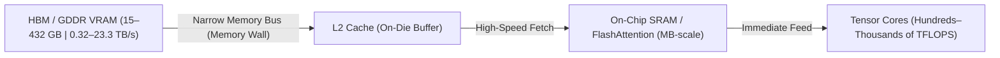
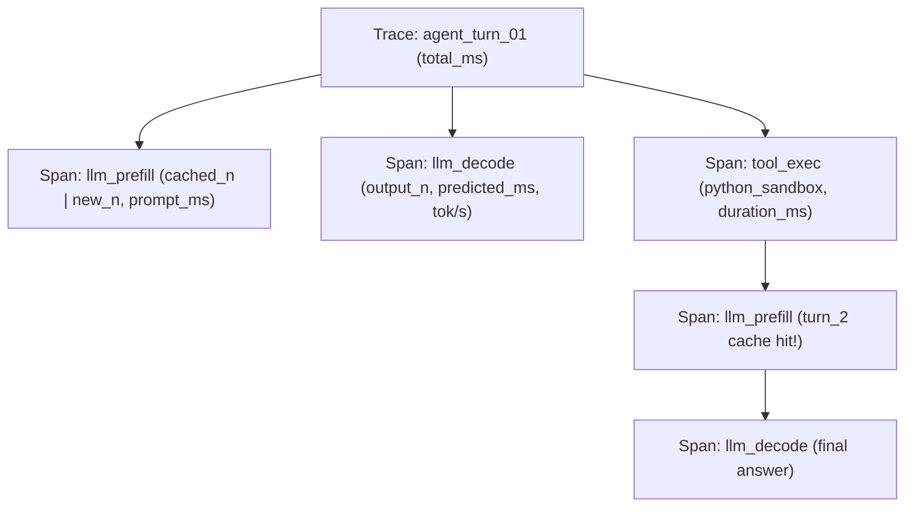
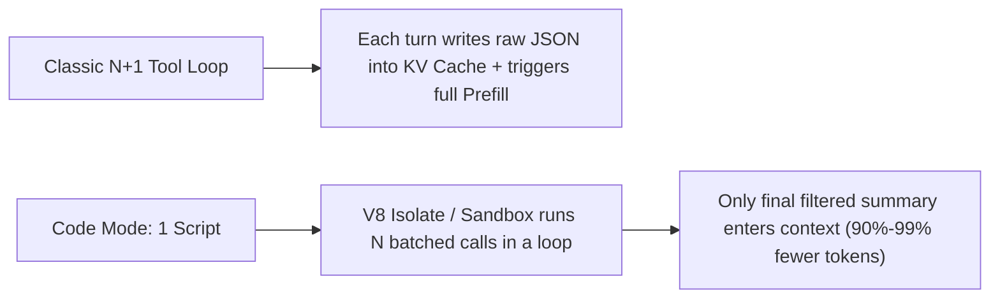

# Lesson notes: Infrastructure, Performance & Evals

[Back to session](README.en.md) | [Türkçe](ders-notlari.md) | [2026 Hardware Reference](hardware-reference-2026.md) | [Glossary](glossary.md) | [Demos](demos/README.en.md) | [Interactive Simulator](demos/inference-visualizer/prefill-decode-kv-sim.html)

Across Days 1–4, we built token/JSON generation, the **harness** loop, `MCP` tool discovery, multi-agent handoffs, and `Sandbox`/`HITL` safety boundaries. Today's question is: **Once a safe agent enters real traffic, how do we make it fast, shrink its memory and energy budget, trace every step, and verify quality systematically?** These notes map directly to the **7-cell `#@title` Colab notebooks** ([demos](demos/README.en.md))—running **`Gemma 4 12B QAT + MTP`** apples-to-apples across `G4/H100`, `L4`, and `T4`—and the offline [interactive simulator](demos/inference-visualizer/prefill-decode-kv-sim.html).

## 5-Minute Day 1–4 Bridge Summary

> **Lecture pacing rule:** We do not spend live class repeating Days 1–4; full notes stay available for self-study ([Day 1](../01-llm-fundamentals/lesson-notes.md), [Day 2](../02-agent-core-and-state/lesson-notes.md), [Day 3](../03-modern-agent-stack/lesson-notes.md), [Day 4](../04-security-and-execution/lesson-notes.md)). You only need these **4 prerequisites** for Day 5:

| Day | Key Concept | One-Sentence Takeaway for Day 5 |
| --- | --- | --- |
| **Day 1** | **Tokens, Matrices & Structured Output** | Every request turns token IDs into matrix/vector multiplies; schema-valid output can still be slow, costly, or wrong. |
| **Day 2** | **Agent Harness & KV/State Memory** | The loop (`Plan → Act → Observe`) executes in the external harness; each added turn grows context, KV memory, and prefill load. |
| **Day 3** | **MCP, Handoffs & Rule Gates** | Multi-agent handoffs and tool calls trigger repeated LLM turns; short-circuiting trivial checks in deterministic gates cuts cost immediately. |
| **Day 4** | **Sandbox, HITL & Durable Execution** | Real code execution and `checkpoint`/`resume` are production-ready; today we engineer their speed, `KV`, `$/1M Token`, `Joule/Token`, `Tracing`, and `Evals`. |

---

## 1. Inference Performance, Memory Hierarchy & Roofline Model (5.1)

Running an LLM (*Inference*) splits into two distinct physical regimes: **Prefill** (digesting input tokens) and **Decode** (emitting tokens one step at a time). Understanding this split drives every hardware and serving choice. (Explore the live animations in [simulator Tabs 1 & 2](demos/inference-visualizer/prefill-decode-kv-sim.html) and full accelerator tables in the [2026 Hardware Reference](hardware-reference-2026.md).)

### 1.1 GPU Memory Hierarchy (`HBM → L2 → SRAM → Tensor Cores`) & the Memory Wall

Compute units (**Tensor Cores**) only consume operands from tiny, ultra-fast on-die **SRAM** (registers / shared memory), while model weights sit in larger off-compute **HBM / GDDR** memory:



The **Roofline Model** reveals two opposing regimes:
- **Compute-Bound:** Whenever one weight fetch serves many tokens simultaneously (**Prefill** or large **Batch**), Tensor Cores run near full utilization.
- **Memory-Bound (Memory Wall):** During single-user (`batch=1`) autoregressive **Decode**, generating each token requires streaming **all active weights** from HBM/VRAM again. Over 95% of Tensor Core capacity stalls waiting on memory, capping decode speed at:

$$\text{Max tok/s} \approx \frac{\text{Memory Bandwidth (GB/s)}}{\text{Active Weights (GB)}}$$

For **`Gemma 4 12B Q4_0` (`~7.2 GB`)**, the theoretical decode ceiling is **`~44 tok/s`** on `Tesla T4` (`320 GB/s`), **`~249 tok/s`** on `RTX PRO 6000 Blackwell` (`1,792 GB/s`), **`~465 tok/s`** on `NVIDIA H100 SXM` (`3.35 TB/s`), and **`~3,236 tok/s`** on `AMD MI455X` (`23.3 TB/s` HBM4); real runs typically reach **60–80%** of ceiling due to kernel overhead, KV reads, and MTP scaling.

### 1.2 Cerebras Wafer-Scale (`WSE-3 / WSE-3T CS-4`) vs. GPU Clusters

Conventional GPUs hit the memory wall because HBM sits off-die. **Cerebras** leaves an entire 300 mm silicon wafer uncut as one chip, placing **`44 GB` of On-Chip SRAM** directly inside `900,000` SLAC cores:
- **`WSE-3` (`CS-3`):** `21.0 PB/s` on-chip SRAM bandwidth, `125 PFLOPS` (sparse).
- **`WSE-3 Turbo / WSE-3T` (`CS-4`):** **`43.2 PB/s`** on-chip SRAM bandwidth, **`250 PFLOPS`** / wafer (`53.5 PB/s` on-wafer fabric; `750 PFLOPS` per `3×` CS-4 rack). *(Note: As of November 2026, official `WSE-4` specs have not shipped, so the active flagship is `WSE-3T` inside `CS-4`.)*
- **Live Impact & Trade-off:** Because weights reside in on-chip SRAM, there is no HBM wall (`GPT-5.6 Sol Ultrafast ~750 tok/s`, ~`14×` speedup at exact precision without distillation). However, wafer-scale delivers lower dense matrix compute density (FLOPS/$) than GPU/TPU pods at equal power/cost, so GPU/TPU clusters remain dominant for massive **pre-training** while wafer-scale excels at **ultra-low-latency decode and agentic loops**.

### 1.3 Chunked Prefill (`--ubatch-size`), Pure Decode (`GEMV`) & Continuous Batching

| Phase / Strategy | Matrix Operation | Roofline Regime | Practical Effect |
| --- | --- | --- | --- |
| **Chunked Prefill (`--ubatch-size`)** | `[B × d] × W` (**GEMM** — matrix × matrix) | **Compute-Bound** | Splits long prompts into `64..512`-token chunks to populate KV shelves without starving concurrent decode requests. |
| **Pure Decode (`batch=1`)** | `[1 × d] × W` (**GEMV** — matrix × vector) | **Memory-Bound** | Reads all weights for 1 token per step; Tensor Cores sit idle and **TPOT** tracks memory bandwidth. |
| **Continuous Batching (`N` users)** | `[N × d] × W` (**GEMM**) | **Shifts toward Compute-Bound** | Merges `N` users at iteration level so one weight read produces `N` tokens, multiplying aggregate `tok/s`. |

### 1.4 Quantization (`FP16 / FP8 / NVFP4 / Q4_0`) & Speculative Decoding (`MTP` & `DFLASH`)

- **Quantization:** Storing weights and KV tensors in **`FP8`** (`1 byte`), **`NVFP4`**, or **`Q4_0`** (`~0.5 bytes`) instead of `FP16` (`2 bytes`) cuts memory-wall traffic by 2×–4×, unlocking both higher `tok/s` and larger context capacity.
- **MTP (Multi-Token Prediction):** A lightweight draft head (e.g., `gemma-4-12B-it-assistant`, `4` layers, `~253 MB`) proposes `k` sequential candidate tokens that the base model verifies **losslessly** in one mini-GEMM pass. Crucial production note: **MTP works in BOTH single-user (`batch=1`) and multi-user `Continuous Batching`** (e.g., Session 02 G4 `vLLM` 8-session MTP5 reached `619.2 tok/s`).
- **DFLASH (Block Diffusion Speculative Decoding):** Instead of generating draft tokens sequentially (`t+1, t+2, ...`), DFLASH uses a single parallel block-diffusion forward pass to propose **`8–16` draft tokens at once**, verified losslessly in one mini-GEMM step—eliminating sequential drafting latency when acceptance rate (`α`) is high.

<details>
<summary>🔬 Optional Deep Dive: Exact <code>Gemma 4 12B</code> (<code>config.json</code>) Dimensions & Minimal PyTorch Reference</summary>

Kept inside a collapsible section so beginners can focus on intuition first (the same dimensions and snippet live inside the simulator's `🔬 Matematik & PyTorch` drawer):

- **Vocabulary & Embeddings:** `vocab_size (V) = 262,144`, hidden size `d_model = 3,840`, input embedding `E[ids]` **tied (`E^T`)** with the LM head, logit `softcap = 30.0`.
- **Layer Layout (`L = 48`):** `40` **Sliding Attention** layers (`sliding_window = 1024`, `16 Q / 8 KV` heads, `d_h = 256`) + `8` **Global Attention** layers (`16 Q / 1 KV` head, `d_h = 512`, **shared `K = V`**).
- **MLP:** `GeGLU` (`d_ff = 15,360`).

```python
import torch, torch.nn as nn, torch.nn.functional as F

class Gemma4MiniModel(nn.Module):
    def __init__(self, V=262144, d=3840, d_ff=15360):
        super().__init__()
        self.embed = nn.Embedding(V, d)                 # [V, 3840] (tied output E^T)
        self.q_proj = nn.Linear(d, 16 * 256, bias=False)
        self.k_proj = nn.Linear(d, 8 * 256, bias=False)
        self.v_proj = nn.Linear(d, 8 * 256, bias=False)
        self.gate = nn.Linear(d, d_ff, bias=False)
        self.up = nn.Linear(d, d_ff, bias=False)
        self.down = nn.Linear(d_ff, d, bias=False)

    def forward(self, ids, kv_cache=None):
        x = self.embed(ids)                             # Prefill: [B, T, d] | Decode: [B, 1, d]
        q, k, v = self.q_proj(x), self.k_proj(x), self.v_proj(x)
        if kv_cache is not None:                        # Append/read cached KV during decode
            k = torch.cat([kv_cache[0], k], dim=1)
            v = torch.cat([kv_cache[1], v], dim=1)
        x = x + F.scaled_dot_product_attention(q, k, v, is_causal=(x.size(1) > 1))
        x = x + self.down(F.gelu(self.gate(x), approximate="tanh") * self.up(x))
        logits = 30.0 * torch.tanh((x @ self.embed.weight.T) / 30.0)
        return logits, (k, v)
```

</details>

### Experiment 1 (`Deney 1`): Prefill (`ubatch`) vs. Decode (`GEMV`) and KV Math

In **Cell 2 (`Deney 1`)**, inspect exact `Gemma 4 12B` `config.json` dimensions, compare `768 KB/tok` vs. `4 KB/tok` vs. `890 B/tok`, run the mini shape/cache demo, and benchmark short vs. long prompts on `ALAB_RUNTIME` (`TTFT (ms)`, `Prefill tok/s`, `Decode tok/s`); then sweep `Concurrent Users N` in [prefill-decode-kv-sim.html](demos/inference-visualizer/prefill-decode-kv-sim.html) to watch `[1 × 3840]` shift into `[N × 3840]`.

---

## 2. Caching & KV Memory Engineering (5.2)

In long-context (`256K`–`1M`) agents, **KV Cache**—the Key/Value tensors retained from earlier tokens—can outgrow model weights unless engineered carefully:

| Architecture / KV Format | KV Cost per Token | `256K` (`262,144`) Context | `1M` (`1,048,576`) Context | Key Mechanism |
| --- | --- | --- | --- | --- |
| **Naive 48L FP16 MHA** (32 heads) | **`768 KB/tok`** | `~192 GB` | **`768 GB`** | Exceeds single-GPU VRAM |
| **`Gemma 4 12B` FP16** | `8 KB/tok` | `~2 GiB` | `~8 GiB` | 40 Sliding@1024 + 8 Global (`1 KV`, `d_h=512`, `K=V`) |
| **`Gemma 4 12B` FP8 (`f8_e4m3`)** | **`4 KB/tok`** | **`~1 GiB`** | **`~4 GiB`** | `512K` GPU KV on `T4`/`L4`, `1M` GPU KV on `G4/H100`! |
| **`DeepSeek-V4-Flash`** | `~3.5 KB/tok` | `~0.9 GB` | `~3.5 GB` | MLA compressed latent KV |
| **`DeepSeek-V4.1-Flash`** (`CED + CSA2 + FP4 KV`) | **`890 B/tok`** | `~222 MB` | **`< 0.9 GB`** | Fits `1M` context KV under `1 GB` |

### 2.1 Prefix Caching (`cache_prompt=True`) & `DualLayerSessionStore`

Multi-turn agent prompts reuse the exact same system prompt, tool schemas (`MCP`), and conversation prefix, appending only the latest message or tool output. **`Prefix Caching` (`cache_prompt=True`)** skips *Cold Prefill* recomputation and serves *Warm Cache Hits*, slashing `TTFT`. AgentLab's **`DualLayerSessionStore`** pairs fast GPU VRAM KV pools with host RAM prompt caching (`--cache-ram`: `3072 MiB` on T4, `8192 MiB` on L4/G4).

### 2.2 Live Case Study (Session 03 L4 Run): "Why Did We Get a Cache Miss?"

During a Session 03 live L4 test, **`Cached: 0 | New: 2410`** and `kv_save.n_saved = 0` occurred—not from user error, but from **three real inference mechanisms stacking together**:

1. **Chat Template Token Shift (`enable_thinking=False`):**
   - Gemma 4's official Jinja `chat_template` injects `<|channel>thought\n<channel|>` after `<|turn>model\n` on Turn 1 to suppress thinking, followed by the long reply (`~2,350` tokens).
   - On Turn 2, if the saved `assistant` message has no `reasoning_content`, the template omits that empty thought block.
   - As a result, Turn 1's reply shifts **3 tokens left** in Turn 2's prompt, breaking prefix matching right after the initial user question (~token `30`).
2. **Hybrid Architecture & `Sliding Window = 1024` (`n_swa = 1024`):**
   - Gemma 4 12B uses a `1024`-token sliding window in local layers.
   - Once context exceeds `1024` tokens, early SWA states roll out (`pos_min` advances) and `llama-server` disables KV shifting (`--cache-reuse`) on SWA contexts; without a matching `--ctx-checkpoints` entry, it falls back to full recomputation (`n_past = 0`).
3. **Parallel Slot Routing (`--parallel 2`, `slot_prompt_similarity = 0.1`, Unpinned `id_slot`):**
   - With `~30` matching prefix tokens out of `2410` total (`30 / 2410 = 1.2% < 10%`), `llama-server` routes Turn 2 via LRU to idle `Slot 1` instead of `Slot 0` (`Cached: 0 | New: 2410`). Likewise, unpinned `/slots/0?action=save` can snapshot idle `Slot 0` (`n_saved = 0`).

- **Why Short Prompts Still Hit:** A fixed-prefix `Harness + MCP` run (`356 / 373 = 95.4% > 10%`) and the short `E5` session test (`63 / 68 = 92.6% > 10%`) stayed well under `1024` tokens and far above the `10%` slot similarity threshold.
- **Production Fixes:** Keep `enable_thinking=True` + `preserve_thinking=True` (eliminating the 3-token template shift), pin `id_slot = 0` for single-user sessions, and use `--swa-full` (or `vLLM` Automatic Prefix Caching).

---

## 3. Cost & AI Factory Energy Economics (`$/1M Token` & `Joule/Token`) (5.3)

In modern AI factories, **grid power (Megawatts) and energy per token** constrain scale alongside silicon capex. Two core equations govern serving economics:

```text
Total Energy (Joule)   = ∫ P(t) dt ≈ Σ [0.5 × (P_i + P_{i+1}) × Δt_i]
Energy / Token (Joule) = Total Energy (Joule) / Total Generated Tokens
Cost (1M Tokens)       = (GPU Hourly Rate × (Wall_Seconds / 3600) / Total_Tokens) × 1_000_000
```

- **Why `Total Energy / Total Tokens` & Why OpenAI-Scale Providers Depend on Continuous Batching:** Dividing a single instantaneous Watt sample misses power variation; integrating sampled power ($\int P(t)\,dt$) over the entire generation window and dividing by total tokens is physically exact. Crucially, under `batch=1`, the GPU reads the same `~7.2 GB` weights per token and charges idle board power to a single user. **OpenAI, Anthropic, and NVIDIA AI Factory** clusters run high-concurrency **Continuous Batching** (`8–128+` users sharing each weight read) because aggregate `tok/s` multiplies while Wattage rises modestly — driving down both **`$/1M Token`** and **`Joule/Token`**.

| Verified AgentLab Baseline / Scenario | Output Speed (`tok/s`) | Power Draw (`Watt`) | Energy (`Joule/Token`) | Key Insight |
| --- | --- | --- | --- | --- |
| **Session 03 `Tesla T4`** (`batch=1` single stream) | `16.74 tok/s` | `38.99 W` | **`~2.33 J/tok`** | Baseline board power is amortized over only 1 stream. |
| **Session 03 `G4` (`llama.cpp` single stream)** | `72.14 tok/s` *(prefill `4776.48 tok/s`)* | — | — | GDDR7 (`1.79 TB/s`) accelerates single-stream decode ~`4.3×`. |
| **Session 02 `G4` (`vLLM` 8-Session + MTP5)** | **`619.2 tok/s`** | `~285 W` TDP | **`~0.46 J/tok`** | **`~5×` lower Joule/Token!** Total `tok/s` multiplies while power rises modestly. |

### Experiment 2 (`Deney 2`): Cold vs. Warm Prefix Caching & Live Energy/Cost Counter

In **Cell 3 (`Deney 2`)**, send an identical long system+context prompt twice with `cache_prompt=True` to measure Cold Prefill vs. Warm Prefix Cache (`cached_tokens`, `prompt_ms`, speedup ratio), then integrate high-frequency `nvidia-smi` `power.draw` samples ($\int P(t)\,dt$) across **Single-User (`1`) vs. Continuous Batching (`8` slots on G4/H100, `2` on L4/T4)** to observe exact **`Total Energy / Total Tokens` (`Joule/Token`)** and **`CU / 1M Token`** savings alongside 2026 hardware reference rows (`T4`, `L4`, `G4`, `H100`, `MI455X`, `TPU 8i`, `M5 Ultra`, `Cerebras WSE-3T`).

> **Engine Scaling Nuance (`llama.cpp` vs. `vLLM`):** Notice that `llama.cpp` is primarily tuned for low-concurrency local/few-user decode rather than high-tenant serving; even so, `1 → 8` slots on G4 still demonstrates `~3.3×` throughput and `~74%` lower `Joule/Token` live, whereas large-scale multi-tenant clusters (`16–128+` users) switch to `vLLM`, `SGLang`, or `TensorRT-LLM` for `PagedAttention` + FP8/NVFP4 Tensor Core saturation.

---

## 4. Observability & Tracing (5.4)

In production, "the agent answered" is insufficient—we need step-level latency, token, and power visibility:
- **Server `/metrics` & `timings`:** `llama-server` and `vLLM` expose Prometheus `/metrics` (KV pool utilization, running/queued slots, generation throughput), while per-response `timings` (`prompt_n`, `prompt_ms`, `predicted_n`, `predicted_ms`, `cache_n`) give exact `TTFT` and `TPOT`.
- **Span Tree:** Every agent turn records child **spans** under a root `trace_id`:
  - `llm_prefill`: `cached_tokens`, `new_prompt_tokens`, `prompt_ms`
  - `llm_decode`: `output_tokens`, `predicted_ms`, `tok_s`, `mtp_acceptance`
  - `tool_exec`: tool name, sandbox status, `duration_ms`
- **`Canlı Stüdyo` Telemetry:** `Cell 5` updates live **`Cached | New`**, **`Output`**, and **`tok/s`** badges on every turn.



---

## 5. Evals, Artificial Analysis & 2026 Frontier Architecture Finale (5.5)

Because LLM outputs are probabilistic, "it worked once on my prompt" fails in production. A complete **Eval** suite combines three layers:

| Eval Layer | What It Measures | Examples & Pitfalls |
| --- | --- | --- |
| **1. Deterministic Evals** | JSON Schema validity, required keys, tool name/arg accuracy, code compilation & unit tests | Fast, `0`-token or low cost, zero judge bias; cannot grade open-ended reasoning alone. |
| **2. Trajectory Evals** | Step order, tool selection efficiency, redundant/looping calls | Catches agents that reach the right final answer after 8 wasted tool calls (preventing `$/1M Token` waste). |
| **3. LLM-as-a-Judge** | Scoring synthesis quality, groundedness, and rubric adherence | **Pitfalls:** *length bias* (favoring verbose answers), *self-preference*, and *position bias* (favoring option A) — mitigate with strict rubrics and position swapping! |

- **Quantization Evals (`FP8` vs. `NVFP4` / `Q4_0`):** Always benchmark multi-step tool calling and strict JSON Schema compliance after quantizing to 4-bit so speed gains never silently degrade reliability.
- **Artificial Analysis Pareto Axes:** Model selection optimizes the Pareto frontier plotting Intelligence/Quality against **Price (`$/1M Token`)**, **Speed (`tok/s`)**, and **Latency (`TTFT`)**.

### 2026 Frontier Architectures Grand Finale Table

| Model | Architecture & Scale | Key Systems / Memory Advantage | Sweet-Spot Eval / Workload |
| --- | --- | --- | --- |
| **`Gemma 4 12B`** | Dense (`12B`) · `40` SWA@1024 + `8` Global (`K=V`) | **`4 KB/tok`** FP8 KV, `7.2 GB` Q4 footprint; `512K` KV + MTP even on a single `T4` | Local/Colab agent baseline, apples-to-apples hardware benchmarking, native multimodal + tools |
| **`Gemma 4 26B A4B`** | MoE (`26B` total / **`4B` active**) | Streams only `4B` active weights per decode step → high `tok/s` | Price/speed Pareto frontier, high-concurrency agent workflows |
| **`Qwen 3.8 27B`** | Hybrid `3:1` (**`48` Gated DeltaNet + `16` Full Attention**) | Linear-time Gated DeltaNet layers for long-context efficiency + `NVFP4`/MTP5 | Deep reasoning (`Thinking: xhigh`), coding, and multi-step tool planning |
| **`DeepSeek-V4-Flash`** | MoE + MLA compressed KV | `~3.5 KB/tok` KV memory and ultra-low serving cost | High-volume API inference and cost-sensitive orchestration |
| **`DeepSeek-V4.1-Flash`** | MoE + **`CED + CSA2 + FP4 KV`** | **`890 B/tok`** (`< 0.9 GB` KV at **`1M` context**!) | Ultra-long-context (`1M`) agents and massive `Continuous Batching` density |
| **`Kimi 3.1 Pro`** | Frontier Reasoning & Agentic MoE | Long-horizon multi-step agent planning and code/tool resilience | Complex autonomous tasks requiring top intelligence & trajectory scores |

### Experiment 3 (`Deney 3`) & Live Studio (`Cell 4`–`Cell 6`)

- **Cell 4 (`Deney 3`):** Executes a traced multi-step agent turn saving `llm_prefill` / `llm_decode` / `tool_exec` JSON spans to `day-05-infra-evals`, runs the 3-check **Mini Agent Eval Suite** (deterministic + trajectory + LLM-as-a-Judge), and prints the 2026 Frontier Architecture table.
- **Cell 5 (`Canlı Stüdyo`):** Try Day 5 preset chips (`⚡ Prefill/Decode & KV Hesapla`, `📊 3 Adımlı Traced Python Analizi`, `🏆 2026 Mimarileri Karşılaştır`) in the portless WebUI and watch live **`Cached | New`**, **`Output`**, and **`tok/s`** telemetry update per turn.
- **Cell 6 (`2. Güvenli Kapanış`):** Flushes `day-05-infra-evals` traces to Google Drive, stops `llama-server`, and releases the VM cleanly.

---

## Extracurricular Bonus: Code Mode — Batched Tool Calling & Sandboxed Orchestration

> **Why include an extra note on this rapidly emerging pattern?** Pioneered by **Cloudflare (`Code Mode`)** and adopted by **Anthropic (`Code Execution with MCP` / `Programmatic Tool Calling [PTC]` & Claude Code)**, this pattern shifts multi-step tool execution from repetitive LLM JSON round-trips into **batched programmatic code executed inside an isolated sandbox**.

1. **Two Infrastructure Bottlenecks It Solves ("MCP Context Tax" & `N+1` Round-Trips):**
   - **Schema Bloat:** Injecting hundreds or thousands of raw JSON-RPC MCP tool definitions burns massive context upfront (e.g., Cloudflare's `~2,500+` API endpoints would consume `~1.17M` tokens before a prompt even begins).
   - **`N+1` Prefill & KV Bloat:** In classic turn-by-turn loops (*call tool -> append raw JSON log -> re-run prefill -> decide next call*), raw intermediate payloads flood the KV cache and multiply `TTFT` + `$/1M Token` cost.
2. **How It Works (`search()` + `execute()` + RPC Sandbox Bridge):**
   - Instead of dumping 1,000+ tool schemas, the model sees ~2 typed primitives such as **`search()` + `execute()`** alongside concise SDK type definitions (~`1,000` tokens — **`99%+` footprint reduction**).
   - Rather than issuing one JSON tool call per turn, the model writes a short **TypeScript/JavaScript or Python script** that loops, filters, and **batches multiple tool invocations** in one pass.
   - **Cloudflare (`@cloudflare/codemode`):** Runs model-written TypeScript inside millisecond-startup **V8 Isolates (Dynamic Workers)** with `globalOutbound: null` (no ambient internet access) and **Workers RPC** bridges so API secrets never enter the sandbox.
   - **Anthropic (`Code Execution with MCP` / `PTC`):** Executes orchestration scripts inside isolated containers or OS sandboxes (`bubblewrap` / `sandbox-exec`), routinely achieving **`90–99%` token reduction** on data-heavy multi-step workflows.
   - All loops and bulky intermediate payloads stay inside the sandbox; **only the distilled final output** enters the LLM's context window.



- **Day 1–5 Synthesis & Trade-offs:** **Code Mode** unifies Day 3 (`MCP` & Progressive Disclosure), Day 4 (`Sandbox` isolation), and Day 5 (`KV Cache` + `$/1M Token` + `Observability`). Key trade-offs: **(1)** strict sandbox hardening is mandatory for generated code; **(2)** trivial single-tool calls don't benefit from codegen latency; **(3)** inner RPC calls must still emit **Trace Spans** so Observability stays intact.

## Before leaving

- Explain why single-user `Decode (GEMV)` is `Memory-Bound` and how `Continuous Batching`, `MTP`, and `DFLASH` overcome it.
- Contrast `768 KB/tok` vs. `4 KB/tok` vs. `890 B/tok` KV footprints and list all three root causes of the Session 03 L4 Cache Miss case study.
- Show via `$/1M Token` and `Joule/Token` why concurrent batching multiplies AI Factory efficiency compared to `batch=1`.
- Distinguish Deterministic, Trajectory, and LLM-as-a-Judge evals and justify 2026 model selection along **Artificial Analysis Pareto** axes.

Reinforce these concepts in the [exercises](exercises/README.en.md), consult full accelerator specs in the [2026 Hardware Reference](hardware-reference-2026.md), and review the notebook walkthrough in the [demo guide](demos/README.en.md).
